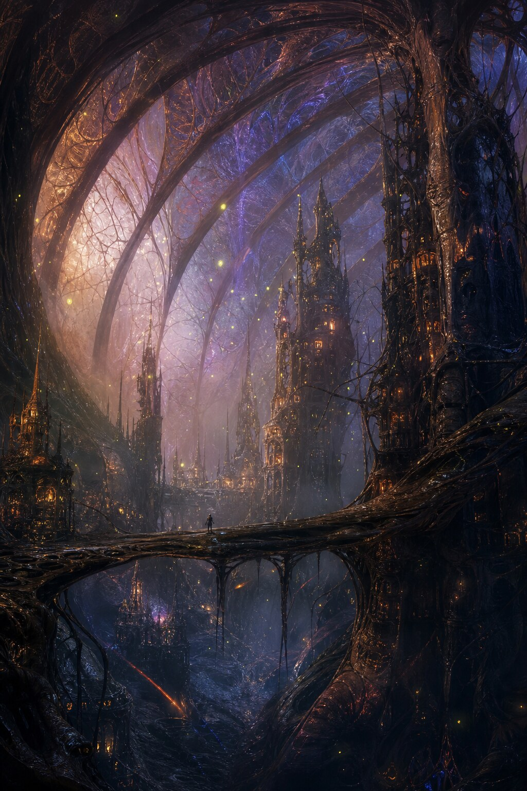
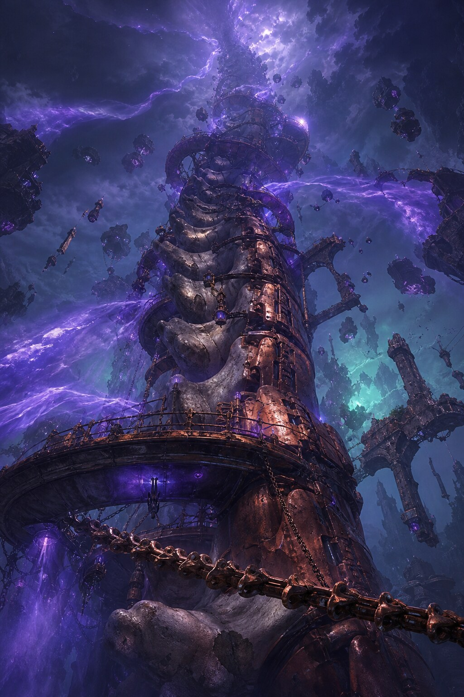
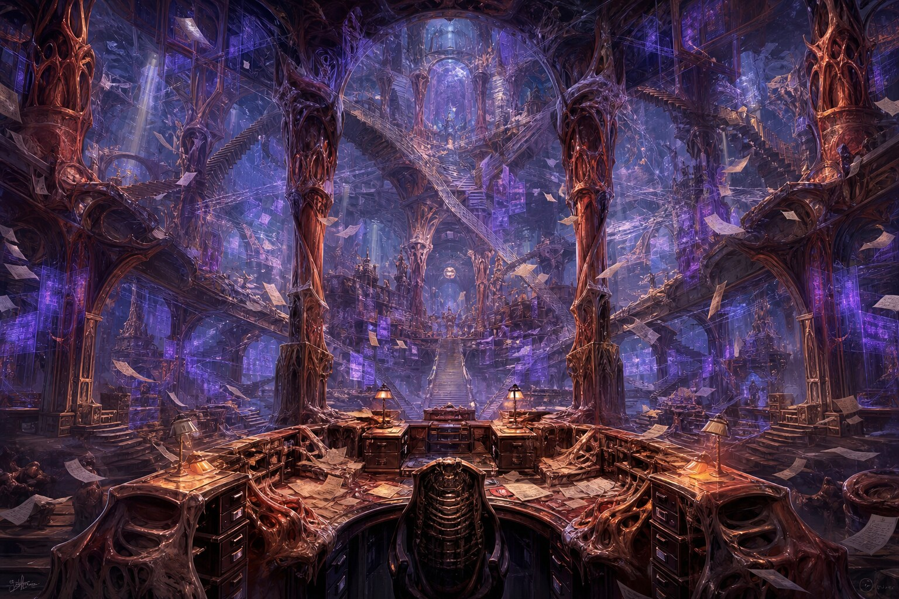
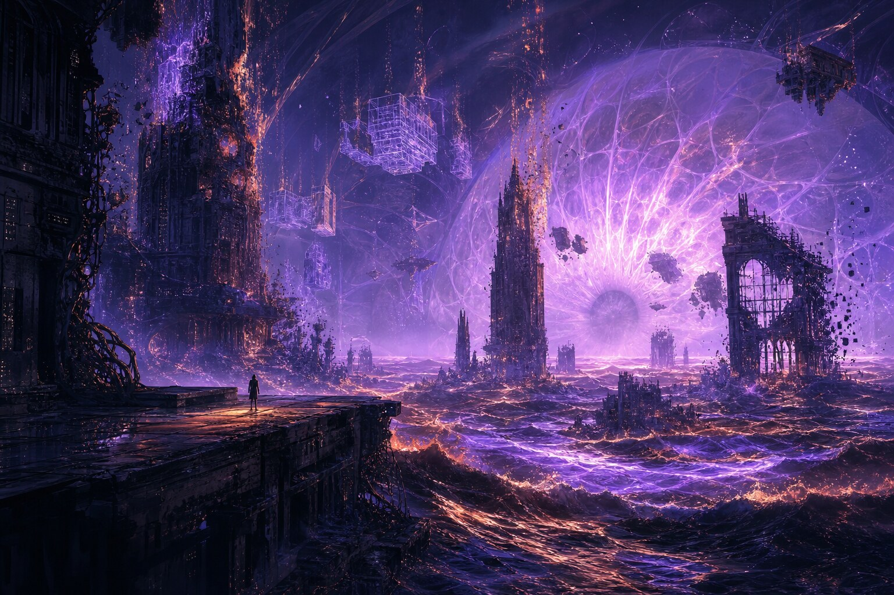
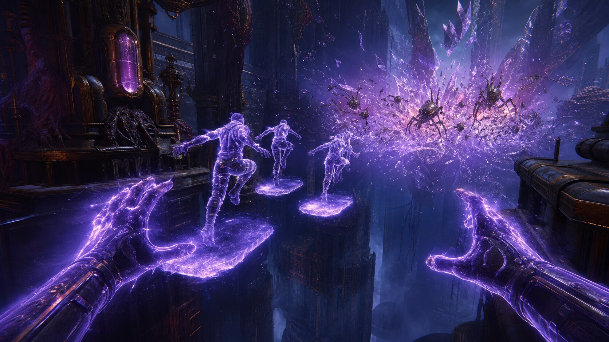
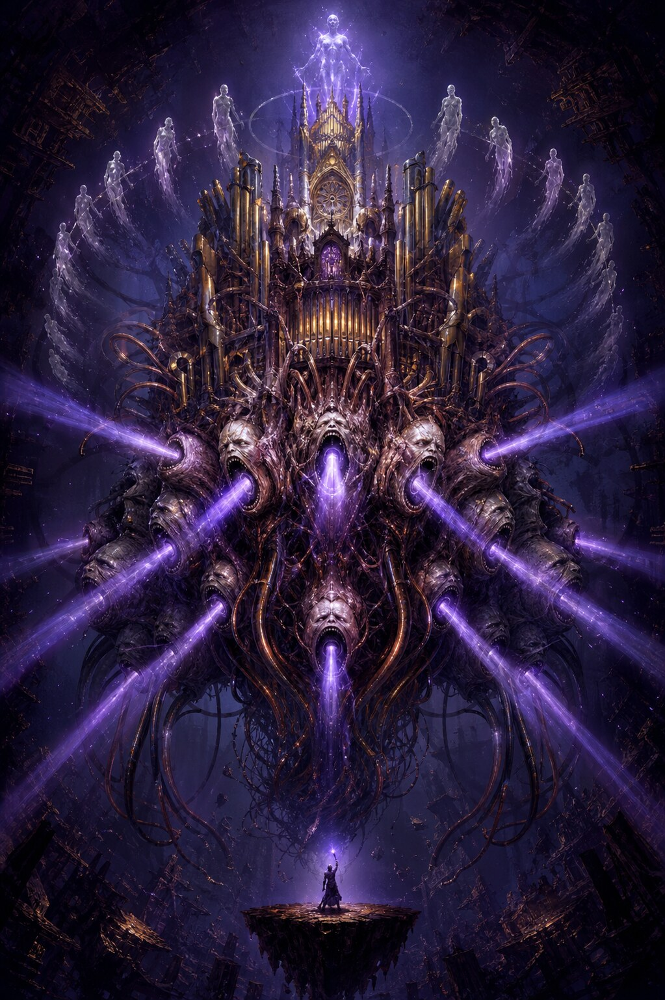

# АРХИТЕКТОР ПАРАДОКСОВ
### Концепт-документ v1.0 · сюрреалистический FPS-адвенчер о манипуляции пространством и временем

> **Одна строка:** ты — существо, которое может на 8 секунд отменить законы физики в радиусе 18 метров, и мир, который этому сопротивляется.

| | |
|---|---|
| **Жанр** | First-person action-adventure / immersive sim |
| **Платформы** | PC (приоритет), PS5 / Xbox Series |
| **Движок** | Unreal Engine 5 (Nanite + Lumen + Chaos) |
| **Длительность** | 12–15 часов кампании + «шрамы мира» (реиграбельность) |
| **Режим** | одиночный, без катсцен-прослоек (кроме интро) |
| **Ключевой цикл** | сломать → слепить → откатить → использовать последствия как оружие |
| **Референсы** | *Prey* (иммерсивность систем), *Returnal* (темп), *Control* (архитектура как персонаж), *Braid* (перемотка как язык), *Dreams* (лепка), *Escher* (геометрия) |

---

## 0. Что игрок покупает за первые 90 секунд

Ты стоишь на краю дышащей каверны. Мост рухнул четыре секунды назад. Ты поднимаешь руку, мир вокруг идёт рябью — и мост **собирается обратно из обломков**, камень натекает на камень, как обратное видео. Ты идёшь по нему. На середине мост снова начинает рассыпаться — потому что ты уже потратил его прошлое, и теперь у него нет настоящего.

Ты прыгаешь. В воздухе ты оставляешь **призрак себя** — он застывает там, где ты был, и по нему можно бежать. За твоей спиной призрак начинает медленно петь.

**Ни одного диалога. Ни одной катсцены. Только глаголы.**

---

## 1. Мир: Мегаструктура «Хор»

Цивилизация Хора растворилась в сингулярности — но не исчезла. Она **стала зданием**. Триллион сознаний слились в один живой организм размером с континент: собор из мышц, кости, меди и оптоволокна, который непрерывно перестраивает сам себя.

Отсюда — все странности мира, и у каждой есть механическая причина:

| Визуальная странность | Механическая причина | Как играет |
|---|---|---|
| Здания растут как растения | Хор всё ещё строит, просто медленно и без цели | перемотка = управление ростом |
| Гравитация течёт как жидкость | Организм перекачивает «вес» как кровь | приливы, боковая гравитация, падение как инструмент |
| Архитектура помнит прошлые версии себя | Сознания-строители не отпустили чертежи | слой «памяти» — бесплатная разведка и платформы |
| Всё дышит | Единый ритм организма (12 с) | тайминг перемоток и роста |
| Коридоры повторяются | Хор не умеет считать этажи | неевклидовы петли, «комната на 8 секунд раньше» |

**Ты — Разломщик.** Не человек и не Хор: ошибка между ними. Кусок нерастворённого сознания, который научился **не подчиняться** — на очень маленьком участке пространства и на очень короткое время. Твой пузырь разлома — это дырка в законах мира диаметром 18 метров. Мир её чувствует, мир её латает, мир за неё платит.

**Центральный конфликт.** Ядро Хора нестабильно. Есть два выхода, и оба — действия, а не выбор в диалоге:

- **Стабилизировать** — сшить мир обратно в один закон. Стать хирургом. Скучно, страшно, дорого.
- **Довести коллапс** — разорвать до конца и стать новым законом физики самому. Быстро, ярко, необратимо.

Каждый биом, каждая зона, каждый бой двигает тебя по этой шкале — **даже если ты не думал о финале**.

---

## 2. Ядро механик: пузырь разлома

Всё в игре происходит внутри **пузыря радиусом 18 м** (апгрейдится до 25 м) вокруг игрока. За пределами пузыря — обычная, жестокая, неотменяемая реальность. Граница видна: воздух там дрожит и слегка «плывёт», как масло на воде.

Это главное дизайн-решение всей игры: **у тебя есть власть, но она локальная, временная и заметная**. Ты не бог. Ты вандал с очень хорошим инструментом.

### 2.1 Три ресурса (и ни одного «мана-бара»)

| Ресурс | Что это | Откуда | Куда |
|---|---|---|---|
| **Заряд разлома** | «топливо» перемотки, 100 ед., реген 8/с | медленно восстанавливается, быстрее — когда мир спокоен | перемотка 12/с, эхо 5/шт |
| **Масса** | «глина», из которой лепишь, 40 ед., реген 6/с | восстанавливается вне боя | постройки 1–10 ед. |
| **Энтропия зоны** (Индекс разлома, 0–100%) | насколько ты уже сломал это место | растёт от любого вмешательства | не тратится — **это последствие** |

Энтропия — не штраф и не награда. Это **состояние мира**. Она меняет врагов, музыку, геометрию, лут и то, какой финал тебе физически доступен. Подробнее — раздел 9.

### 2.2 Локальная перемотка (Q)

**Правило:** откатывается не весь мир, а только то, что попало в пузырь. Глубина — 8 секунд (апгрейд до 12). Мир вокруг продолжает жить.

Что можно откатить:
- **Разрушенное здание** — собирается обратно. Через 4 секунды после отката оно снова начнёт рассыпаться, потому что его будущее ты уже потратил. Это не баг, это закон: *перемотка не отменяет событие, она отдаёт его тебе в долг*.
- **Рост платформы** — ускоренный откат прокручивает фазу роста: недоросшая платформа вырастает за 1,2 с вместо 20.
- **Врага** — он проживает свои последние 8 секунд заново, **по тому же маршруту**. Это ключ ко всей боевой системе: ты не убиваешь врага, ты **загоняешь его в его собственное прошлое** и там ставишь стену.
- **Себя** — единственный способ лечиться в игре. Смотри 2.5.

Ограничения (чтобы это была игра, а не кнопка «победить»):
- Нельзя откатить то, что **старше 8 секунд** (рухнувший час назад мост — навсегда).
- Нельзя откатить внутри «стежка» Шва (раздел 5.1) и внутри зон, стёртых Мембраной.
- Откат **не бесплатный**: 25% Индекса разлома зоны за крупный откат, 12 ед. заряда в секунду.
- Откат **слышно**: все враги в радиусе 40 м получают твою позицию. Хочешь тихо — не перематывай.
- Откат **нельзя прервать**, но можно прервать ударом (тебя отбрасывает, откат отменяется, история зоны «рвётся» — см. парадокс).

### 2.3 Скульптура реальности (ЛКМ — лепить, ПКМ — уплотнить)

Ты лепишь материю руками, в реальном 3D, с физикой. Не «поставить куб из меню», а **тянуть, сжимать, скручивать**.

- **Лепить:** удерживая ЛКМ, ты вытягиваешь из поверхности (или из воздуха перед собой) объём. Скорость = масса. Отпустил — объект застыл.
- **Уплотнить (ПКМ):** сжать объект в **нестабильную структуру**. Та же глина, но в состоянии «вот-вот». Кристаллизуется 4 секунды, потом коллапсирует. Это твоя «граната».
- **Скрутить:** два пальца + движение = торсионное натяжение. Объект начинает медленно вращаться и **тянуть** всё вокруг. Основа ловушек.
- **Пять «глин»** открываются по ходу игры: **кость** (прочная, тяжёлая), **мембрана** (упругая, пружинит — батут), **медь** (проводит — включает цепи), **желе** (гравитационная, течёт), **стекло** (прозрачное, хрупкое, режет).

**Память объектов.** Каждый созданный тобой объект помнит, как его создали:
- Если ты **бросил** объект — он «научился» падать и в следующий раз сам прыгнет вниз.
- Если объект **пережил коллапс** рядом — он «напуган»: покрывается трещинами и взрывается раньше на 30%.
- Если ты **откатил** объект — он помнит свою предыдущую форму и при следующей лепке воспроизводит её сам (частичный автопилот).
- Объекты, прожившие в зоне долго, **эволюционируют**: у них появляются шипы, дополнительные опоры, дети-наросты. Мир одомашнивает твои инструменты.

*Технически:* SDF-глина на воксельной сетке 32³ внутри пузыря, marching cubes, 200–400 «живых» объектов на зону, у каждого — история из 4 последних состояний.

### 2.4 Эхо-версии (E)

Каждое твоё действие оставляет **призрак** — полупрозрачную копию тебя в момент действия. Призрак не декорация, а **физический объект**.

- **Платформа.** Призрак — твёрдый. По нему можно бежать, стоять, отталкиваться.
- **Оружие.** Призрак можно **толкнуть** (рывок в него): он летит и бьёт как снаряд. Тяжёлый — если в момент записи ты бежал.
- **Ловушка.** Призрак можно **уплотнить** (ПКМ): он становится нестабильным и коллапсирует через 2 с.
- **Приманка.** Враги атакуют призраков, если те «громче» тебя. Швы перематывают их, Мнемофаги их едят.

Бюджет: **3 эха одновременно**, каждое живёт 12 с (в Биоме 3 — 30 с). Эхо **нельзя создать, стоя на эхе**. Эхо **не оставляет эхо**. Эти два правила — вся глубина системы: они не дают бесконечно строить лестницу из себя и заставляют планировать маршрут.

**Парадокс.** Если эхо оказывается **в той же точке**, где находишься ты, — происходит схлопывание: микро-сингулярность 0,8 с, которая всасывает всё в радиусе 4 м. Это и лучший урон в игре, и самый надёжный способ убить себя. Даёт **Осколки-Противоречия**.

### 2.5 Бой через коллапс (никакой стрельбы)

Оружия нет. Есть **нестабильность**.

1. Ты лепишь структуру и **уплотняешь** её → 4 с до коллапса.
2. Коллапс — это взрыв 6 м, 60 урона, разброс обломков.
3. **Каскад:** если коллапс задевает другую нестабильную структуру, она срабатывает тоже, урон ×1,5 за звено (максимум ×3). Цепочки из 4–5 объектов — основной способ сносить элиту.
4. **Самоурон:** 40% от твоего же коллапса, если стоишь в радиусе. Ты — расходник в собственных схемах.
5. **Структурная эвристика:** коллапс наносит ×2 урона тому, что **опирается** на разрушенное. Снеси опору — рухнет всё над ней. Это делает врагов-зданий и «потолки» законной тактикой.

**Лечение = перемотка себя.** Нет аптечек. Есть только откат своего тела на 2–3 секунды назад (≈ минус 25–40 урона за 3 с истории). Это значит: **ты не можешь лечиться, если не двигался и не получал урон** — история должна быть. И это значит, что смертельно раненый игрок лихорадочно ищет, куда убежать, чтобы «набрать прошлое».

### 2.6 Шесть правил, которые превращают хаос в игру

1. **Ничто не бесплатно.** Любая манипуляция повышает Индекс разлома. Мир — не песочница, а кредитор.
2. **Пузырь виден.** Игрок всегда видит границу своей власти — значит, всегда видит и свою беспомощность за ней.
3. **Враг — ресурс.** Шов сшивает твои постройки (это полезно), Мнемофаг ест эхо (это можно использовать), Реверс ломается об стену. Ни один враг не является просто «мешком ХП».
4. **Перемотка оставляет долг.** Откатанное возвращается и снова рушится. Игрок учится **считать секунды вперёд**, а не только назад.
5. **Ошибка — это тоже состояние мира.** Ничего не откатывается «в ноль». Упал в пропасть — мир запомнил.
6. **Каждые 90 секунд — новый глагол.** Перемотка, лепка, эхо, коллапс, парадокс, скульптура-поток. Глаголы комбинируются, а не заменяются.

---

## 3. Четыре биома

Каждый биом — не декорация, а **новый закон физики**, который ты обязан выучить или сломать.

---

### БИОМ 1. ЛЁГКИЕ ХОРА
*«Здесь всё растёт. Даже то, что ты убил.»*

| | |
|---|---|
| **Акт** | 1 · 0:00–2:30 |
| **Вертикаль** | −80 … +200 м |
| **Палитра** | индиго-бездна, мокрая сталь, бирюзовые споры, медные рёбра |
| **Погода** | «дыхание» — цикл 12 секунд |

**Ощущение.** Ты внутри грудной клетки размером с город. Гигантские полупрозрачные мембраны втягиваются и опадают, рёбра из окисленной меди уходят вверх, как контрфорсы. Стены влажные, тёплые, слегка пульсируют. Воздух пахнет железом и озоном. Здания здесь не стоят — они **прорастают**: коралловые башни с окнами тянутся вверх по 2 см в секунду, оставляя за собой строительные леса из собственных корней.

**Закон биома — ДЫХАНИЕ.** Каждые 12 секунд мир делает вдох: всё растущее ускоряется ×6, платформы удлиняются, пропасти сужаются. На выдохе — наоборот: платформы сжимаются, мосты проваливаются, споры вспыхивают.

**Что это даёт механически:**
- **Тайминг.** Перемотка на вдохе «подхватывает» рост и вытягивает платформу туда, куда тебе надо. Перемотка на выдохе — только разрушает.
- **Ритм боя.** Враги тоже дышат. На вдохе они быстрее и злее, на выдохе — уязвимы и «выдыхаются».
- **Мир как лифт.** Растущая башня — бесплатный вертикальный транспорт. Но она растёт по своему плану, а не по твоему.

**Чему учит:** перемотке и базовой лепке. Здесь ещё нет давления — только ощущение, что мир живой и на тебя смотрит.

**Враги:** Шов (обучающий), Мнемофаг (первый), Эхо-рои (сюжетные).
**Ключевой сет-пис:** «Мост, которого уже нет» (раздел 6, A).
**Музыка:** виолончельные педали в такт дыханию, женский хор на вдохе, расстроенный обертоновый кластер на выдохе.

---

### БИОМ 2. МЕДНЫЙ ПОЗВОНОЧНИК
*«Гравитация тут — жидкость. Она течёт вниз по костям. Иногда — вверх.»*

| | |
|---|---|
| **Акт** | 2 · 2:30–5:30 |
| **Вертикаль** | 0 … +600 м (вертикальный биом) |
| **Палитра** | патина, обожжённая медь, чёрный обсидиан, ультрафиолетовые приливы |
| **Погода** | гравитационные приливы каждые 20–40 с |

**Ощущение.** Ты поднимаешься по исполинскому позвоночнику, уходящему в грозовые облака. Каждый позвонок — платформа размером с район. Между ними — провалы, в которых **течёт гравитация**: не вода, а именно вес, сиропом стекающий по кости вниз. Он собирается в «гравитационные водопады», которые падают вбок. Камни, арки и обломки медленно вращаются в воздухе, подчиняясь потоку.

**Закон биома — ЖИДКАЯ ГРАВИТАЦИЯ.** Вектор «вниз» здесь — локальное поле, которое течёт. Есть зоны с боковой гравитацией (идеальные для «прыжков» через пропасть), есть зоны, где гравитация **выключается на 3 секунды** (прилив), есть «водовороты», где всё стягивается в точку.

**Что это даёт механически:**
- **Падение — это оружие.** Сбросить врага в гравитационный водопад = мгновенно, но Индекс разлома растёт от «массового убийства».
- **Лепка из желе.** Новая глина: объекты, которые сами текут по полю. Ты лепишь не форму, а **направление течения**.
- **Перемотка гравитации.** Можно откатить **сам прилив** — и поток на 8 секунд пойдёт вспять. Враги, привыкшие к «внизу», внезапно падают вверх.

**Чему учит:** тому, что среда — такое же оружие, как твои руки, и что «низ» — это договорённость.

**Враги:** Пастух гравитации (элита), Реверс (первая встреча), Шов-сшивальщик (ставит стежки на вертикалях).
**Ключевой момент:** 200-метровый подъём по позвонкам во время «отлива» — гравитация меняется на каждом уровне, и всё, что ты построил, сползает вниз.
**Музыка:** металлическая перкуссия, инфра-бас на приливах, «сердцебиение» на каждом ударе гравитации.

---

### БИОМ 3. КАНЦЕЛЯРИЯ НЕВОЗМОЖНЫХ ЭТАЖЕЙ
*«Здесь здание помнит, каким оно было. И оно тебе этого не простит.»*

| | |
|---|---|
| **Акт** | 3 · 5:30–9:30 |
| **Вертикаль** | −40 … +120 м (но этажей бесконечно) |
| **Палитра** | тёмный янтарь, бумажная пыль, медь, фиолетовые голограммы |
| **Погода** | «ревизия» — здание перестраивает этажи раз в 90 с |

**Ощущение.** Бюрократический собор: бесконечные лестницы, которые соединяются сами с собой, арки, ведущие в арки, полы, складывающиеся в потолки. Лес медных колонн с мышечной текстурой. В воздухе плывут тысячи бумажных документов и светящихся голограмм-дел. За письменными столами «сидят» сросшиеся с мебелью силуэты — они всё ещё оформляют бумаги на здания, которых больше нет.

**Закон биома — ПАМЯТЬ АРХИТЕКТУРЫ.** Здесь **всегда** виден слой прошлого: полупрозрачные версии комнат наложены друг на друга. Ты видишь, каким этот коридор был 8 секунд, 2 минуты и 3 дня назад.

**Что это даёт механически:**
- **Бесплатная разведка.** Слой памяти — навигация: смотри, где была дверь до того, как её замуровали.
- **Эхо здесь материально.** Эхо живёт 30 с вместо 12, и на эхо можно опираться даже в зонах, где перемотка запрещена. Здесь эхо становится основным инструментом, а перемотка — роскошью.
- **Неевклидовы петли.** Дверь может вести в ту же комнату, но **на 8 секунд раньше**. Ты можешь встретить себя. Ты можешь оставить объект «в прошлом» комнаты — и он появится в настоящем, когда прошлое догонит.
- **Здание мстит.** Каждый разрушенный элемент этажа добавляет зданию «обиду» — на следующем цикле ревизии на этом месте вырастает контр-структура: стена, шипы, или копия твоей постройки, но враждебная.

**Чему учит:** перемотка — не единственная ось времени. Пространство тоже можно складывать.

**Враги:** Мнемофаг-архивариус (ест историю целыми комнатами), Шов-ревизор (ставит печать «перемотка запрещена»), Реверс-хор.
**Ключевой момент:** погоня по петле — ты преследуешь себя, чтобы не дать себе же испортить собственный план.
**Музыка:** пиццикато, щелчки печатных машинок и штампов в ритме, при высоком разломе — шорох бумаги и скрежет ломающихся лестниц.

---

### БИОМ 4. МЕМБРАНА
*«Это не конец мира. Это его последний кадр.»*

| | |
|---|---|
| **Акт** | 4 · 9:30–12:30 + босс |
| **Вертикаль** | −200 … +50 м (берег моря сингулярности) |
| **Палитра** | ультрафиолет, магента, чёрная жидкость, медная пена |
| **Погода** | волны стирания каждые 45 с |

**Ощущение.** Берег моря жидкого света. Полурастворённые башни стекают в воду, архитектура пикселизуется и распадается в потоки искр. Вдалеке — колоссальная полупрозрачная мембрана, пульсирующая как внутренность глаза. Чёрные волны с медной пеной. Над водой висят «воспоминания» зданий: их проволочные призраки, которые уже не материя, но ещё помнят форму.

**Закон биома — СТИРАНИЕ.** Волны забывания проходят каждые 45 с и удаляют материю: сначала декор, потом платформы, потом пол. Всё, что стёрто, **не существует** — по нему нельзя пройти, на него нельзя опереться.

**Что это даёт механически:**
- **Перемотка как сопротивление.** Единственный способ вернуть стёртое — откат. Но работает **закон сохранения**: возвращённая материя стирается где-то ещё. Ты играешь в бухгалтерию с миром.
- **Гонка со стиранием.** Каждый откат делает следующий цикл стирания ближе на 5 с.
- **Эхо-толпа.** В финале по мембране бродят эхо-версии всех, кого ты встречал за игру: твои собственные призраки из биомов 1–3, собранные Хором. Они не враждебны — пока ты не начнёшь их использовать.

**Чему учит:** ничто не бесплатно. Совсем ничто.

**Ключевой момент:** путь к ядру по последнему стабильному фрагменту, который **тоже** стирается, — ты буквально идёшь по исчезающей линии.
**Музыка:** тотальный дрон, слои голосов, при 100% Индекса — полная тишина и один удар сердца.

---

## 4. Бестиарий

Враги здесь не «мешают стрелять». Они **отбирают у тебя твои же инструменты**.

### 4.1 ШОВ (Suture) — «хирург стабильности»

| | |
|---|---|
| **Класс** | пехота-контролёр |
| **HP** | 120 (элита 260) |
| **Размер** | 2,6 м |
| **Скорость** | медленная (3 м/с), рывок-стежок 12 м/с |

**Как выглядит.** Высокая фигура из натянутого шёлка и кости. Вместо рук — длинные иглы с нитью из раскалённой меди. На спине — незашитый шов, сквозь который видно пустоту. Двигается рывками, будто его дёргают за нитку.

**Поведение.**
- **Сшивает** твои постройки: прибивает объект к миру на 10 с. Сшитый объект **не участвует в коллапсе** и не откатывается. (Парадокс: это иногда **полезно** — сшитый в воздухе блок становится вечным мостом.)
- **Печатает зону**: раз в 14 с ставит «стежок» — круг радиусом 6 м, внутри которого **перемотка невозможна** 10 с. Визуально — натянутая светящаяся нить вокруг площадки.
- Держит дистанцию, атакует иглой на 9 м (18 урона + «пришивает» тебя на 1 с — нельзя двигаться).

**Слабое место.** Спина. Удар по шву — ×3 урона и он теряет нить на 5 с (не может сшивать и печатать).

**Зачем он нужен игроку.** Шов — **первый урок того, что не всё откатывается**. Он отбирает кнопку «назад» и заставляет использовать эхо и лепку. А ещё он — лучший строитель в игре, если направить его правильно.

**Контр-игра:** заманить к пропасти и дать «сшить» блок над бездной (бесплатный мост); ударить по спине с эха; заставить сшить собственную ногу.

---

### 4.2 МНЕМОФАГ (Memophage) — «пожиратель памяти»

| | |
|---|---|
| **Класс** | летающий паразит-антимаг |
| **HP** | 90 (растёт с каждым съеденным эхо: +25) |
| **Размер** | 1,8 м, раздувается до 4 м |
| **Скорость** | 5 м/с, набухший — 2 м/с |

**Как выглядит.** Полупрозрачная медуза на тонких паучьих лапах. Внутри тела медленно плавают украденные моменты: крошечные эхо, чьи-то руки, лицо, обрывок прыжка. Чем больше съел — тем ярче и тем медленнее.

**Поведение.**
- **Ест эхо** — твои и любые другие. Каждое съеденное: +25 HP ему и **−1 секунда глубины перемотки в зоне** (максимум −4 с). На карте это видно: таймлайн зоны буквально укорачивается.
- Атакует «укусом памяти»: 12 урона и **стирает 1 секунду твоей личной истории** (нельзя откатиться за этот участок — то есть лечиться).
- Набухший Мнемофаг **взрывается** через 8 с: 45 урона по площади и −2 с глубины перемотки навсегда (до конца захода в зону).

**Слабое место.** Пока ест — уязвим ×2. Набухший — фактически бомба.

**Зачем он нужен игроку.** Он **облагает налогом самую крутую механику игры**. Ты начинаешь беречь эхо, как патроны.

**Контр-игра:** дать нажраться и подорвать коллапсом (урон ×2 по набухшему + возврат всей глубины перемотки); убить до того, как съест третье эхо; использовать как мину, заманив к элите.

---

### 4.3 РЕВЕРС (Reversion) — «тот, кто живёт назад»

| | |
|---|---|
| **Класс** | неуязвимый в настоящем дуэлянт |
| **HP** | 70, но убить «в лоб» нельзя |
| **Размер** | 2,2 м |
| **Скорость** | 9 м/с по заранее записанному маршруту |

**Как выглядит.** Скелет из дымчатого стекла, внутри — вращающийся механизм часов. Оставляет за собой шлейф из собственных будущих поз: там, где он был, стоят его «потомки», и они стареют, пока он идёт.

**Поведение (главная идея).**
Реверс идёт **от своей смерти к своему рождению**. В реальном времени его «прошлое» — впереди, а «будущее» — позади. Механически:
- Пока он идёт по маршруту, он **неуязвим спереди**: любой удар, который ты наносишь сейчас, он «уже пережил» — урон не проходит, а летит назад по его таймлайну.
- Он **уязвим в точке рождения** — там, куда он придёт через 20–30 секунд (видно как пульсирующая метка).
- Если сломать его маршрут (поставить на пути стену, обрушить мост) — его таймлайн рвётся: **парадокс-урон ×3**, он разлетается на осколки.

**Три способа убить (и все три — разные механики):**
1. **Догнать прошлое:** перемотка зоны ×2 «обгоняет» его — ты встречаешь его в точке рождения и бьёшь там.
2. **Поставить стену:** скульптура поперёк маршрута. Дешёво, но он ломает стену за 2 с — надо успеть второй.
3. **Столкнуть:** сбить его с маршрута (толчок эхом, коллапс) — таймлайн рвётся, но он становится «свободным» и на 5 с превращается в очень злого обычного врага.

**Зачем он нужен игроку.** Он **превращает перемотку из «кнопки отмены» в оружие**. Это момент, когда игрок понимает, что игра не про защиту, а про нападение временем.

**Контр-игра:** смотреть на метку рождения, планировать маршрут, ломать путь. Или не связываться — он не преследует, он просто идёт.

---

### 4.4 ЭЛИТА: ПАСТУХ ГРАВИТАЦИИ (Gravity Shepherd)
Опциональный мини-босс биома 2. Слепая туша на четырёх костяных ногах, вокруг которой вращается «стадо» — 6–8 камней, летающих по орбитам. Может **украсть твою постройку** и добавить её в стадо. Убивается только каскадом из 3+ объектов или сбросом в гравитационный водопад. Награда: **Осколок-Свидетель** + новая глина «желе».

---

### 4.5 БОСС: ХОР-НОЛЬ · «ПЕРВЫЙ СВИДЕТЕЛЬ»

| | |
|---|---|
| **Класс** | финальный босс, 3 фазы, ~12–15 мин |
| **HP** | 4000 (фазы: 1200 / 1400 / 1400) |
| **Арена** | орга́н-собор 90 × 90 м, три яруса |
| **Пузырь разлома** | 40 м (в два раза больше твоего) |

**Кто это.** Первый Разломщик. Тот, кто сломал мир до тебя, — и не остановился. Хор-Ноль — это то, во что превращается игрок, дошедший до коллапса. Собор, орга́н и мясо: сотни медных труб, сотни кричащих ртов, из каждого бьёт ультрафиолет. Вокруг него по орбите вращается **кольцо замороженных эхо** — все, кем он был.

**Главная идея босса:** он играет **твоими механиками**, но лучше. Он перематывает, он лепит, он оставляет эхо. Разница в том, что его пузырь больше, а ты — быстрее.

#### ФАЗА 1 — «ПРИПЕВ» (1200 HP)
Хор-Ноль материализует **4 эхо-копии игрока** — записанных за последние 60 секунд *твоих* действий. Если ты в это время строил кристаллы, копии строят кристаллы. Если бегал — бегают.

- Копии повторяют твой маршрут с задержкой 8 с и **физически материальны**.
- Босс поёт: раз в 6 с «нота» — расширяющееся кольцо урона, которое нужно перепрыгнуть или перепрыгнуть **по эхо**.
- **Урок:** эхо — обоюдоострое. Игрок впервые видит свои приёмы со стороны.

**Контр:** использовать копии как платформы (они материальны!), сталкивать их друг с другом (парадокс), строить так, чтобы копии строили **полезное** — они повторяют тебя, значит, ты можешь «программировать» их заранее.

#### ФАЗА 2 — «РЕВИЗИЯ» (1400 HP)
Босс **откатывает тебя**. Раз в 20 с — «ревизия»: твоя позиция и твои постройки возвращаются на 8 секунд назад. Твои действия за эти 8 с отменяются. Его — нет.

- Ты оказываешься там, где был, и не помнишь, что делал (интерфейс гаснет на 1,5 с, потом показывает «архив» — краткую вспышку того, что было).
- Оружие против этого — **нестабильные структуры**: если структура уплотнена до ревизии, при откате она возвращается **уже сработавшей** — и рвёт босса изнутри.
- Он также «сшивает» арену, отрезая тебе вертикаль.

**Контр:** играть «в отложенный удар». Ставить кристаллы за 1–2 с до ревизии, чтобы откат превратил их в мину. Ждать ревизию как окно урона.

#### ФАЗА 3 — «СИНГУЛЯРНОСТЬ» (1400 HP)
Арена теряет пол. Ярусы отваливаются по одному. Хор-Ноль **питается твоим Индексом разлома**: чем больше ты ломаешь, тем он сильнее и тем быстрее рушится арена.

Здесь игра ставит главный выбор — **не диалогом, а механикой**:

- **СТАБИЛИЗАЦИЯ:** держать Индекс ниже 20%. Тогда босс слабеет, арена держится, и открывается ритуал «удержать ядро» (60 с стоять в центре, отражая волны). Финал: мир зашит, ты становишься его хирургом. Дорого, медленно, тяжело — но город выживает.
- **КОЛЛАПС:** довести Индекс до 100%. Босс становится колоссом, арена исчезает полностью, ты летишь вместе с ним в сингулярность. Финал: ты становишься новым законом физики. Ярко, быстро, и всё, что ты спас, больше не существует.

Босс **не даёт** тебе сделать это спокойно: обе стратегии он пытается сорвать — стабилизацию «заражает» своими нотами, коллапс — сшивает, чтобы ты не мог ломать. Финальный выбор — это 90 секунд, в которых ты буквально держишь руки на двух противоположных рычагах.

---

## 5. Прогрессия: ОСКОЛКИ СЛОМАННОГО ВРЕМЕНИ

Никаких уровней, никакого XP. Только **осколки** — физические куски отменённых моментов, которые ты вставляешь в себя.

### 5.1 Три сорта

| Сорт | Цвет | Как получить | Куда |
|---|---|---|---|
| **Осколок-Секунда** | медный | любое вмешательство: откат ≥2 с, коллапс, скульптура | расходник: калибровка, ремонт, «топливо» для рискованных приёмов |
| **Осколок-Противоречие** | фиолетовый | **парадоксы**: эхо касается эха; ты в точке своего эха; откат, отменяющий сам себя; убийство врага его же будущим; строительство в своём прошлом | открытие и установка навыков |
| **Осколок-Свидетель** | белый | сюжетные узлы, боссы, элиты, «правильные» решения | открытие веток, лор, финальные опции |

**Осколки нельзя нафармить на мобах.** Стандартный враг даёт 0–2 Секунды и то не всегда. Всё ценное — за **красивые решения**. Игра платит за изобретательность, а не за grind.

### 5.2 Вплетение (основная система)

У Разломщика **6 слотов** — углублений в теле, куда вставляются осколки. Каждый осколок несёт **отпечаток действия**: он подходит, только если ты выполнял это действие.

> **«Осколок помнит твою руку».**

Пример: осколок «Двойной откат» можно установить, только если ты провёл откат, отменяющий другой откат (то есть игрок уже умеет этим пользоваться). Никаких «купил за очки и стал сильнее» — только **освоил и закрепил**.

**Осколки стареют.** Каждое использование установленного навыка расходует его «заряд памяти». Осколок тускнеет (5 стадий), и чтобы восстановить его — нужно **снова выполнить то действие**, которое его создало. Это создаёт петлю:

> используешь навык → осколок тускнеет → идёшь делать то, что умеешь → навык снова сияет.

Никакого гринда — только **ритуальное повторение собственного мастерства**. И это тематически идеально: мир помнит, ты помнишь, всё держится на повторении.

### 5.3 Три ветки-«закона»

Осколки вставляются не в дерево, а в **три вектора личности**. Ты не можешь прокачать всё — установка осколка одного закона **вытесняет** осколок противоположного (слоты общие).

| Ветка | Что даёт | Цена |
|---|---|---|
| **СТАЗИС** (порядок) | перемотка дешевле (−40%), глубина +2 с, эхо держится дольше, можно сшивать трещины | коллапс слабее (−30% урона), Индекс растёт медленнее → финал стабилизации легче |
| **ПОТОП** (масса) | масса +20, постройки крупнее и прочнее, скульптура-поток, можно лепить из стен | перемотка дороже, пузырь −3 м (тяжёлому труднее «рвать») |
| **РАСПАД** (хаос) | коллапс +50% урона, каскады ×1,8, эхо можно взрывать дешевле, самоурон −60% | глубина перемотки −2 с, Индекс растёт быстрее → финал коллапса ближе |

Ветки **не дизъюнктны** — можно смешивать, но каждый слот — это компромисс. Сборка «Стазис 4 + Распад 2» — валидный, играбельный и совершенно другой геймплей.

### 5.4 Шрамы мира (мета-прогрессия)

Между заходами зона **помнит** тебя.

| Ты вёл себя как | Зона становится | Что получаешь |
|---|---|---|
| **разрушитель** | трещины, обвалы, злее враги, но короче пути и богаче парадокс-лут | больше Противоречий, доступ к «сломанным» веткам |
| **стабилизатор** | зона дышит ровно, безопасные пути, меньше врагов | меньше осколков, но открываются «архивные» комнаты с лором и Свидетелями |
| **балансир** | зона в странном равновесии — появляются уникальные гибридные структуры | доступ к «парадокс-комнатам», которых нет ни у кого |

Это **финальный выбор в миниатюре**: каждая зона показывает тебе, кем ты становишься, задолго до последнего экрана.

---

## 6. Сеты плей: одна ситуация — четыре разных решения

Главное обещание immersive sim: **задача одна, ответов — сколько хочешь**. Ниже три сцены с разбором по механикам, цене и награде.

---

### СЕТ A. «МОСТ, КОТОРОГО УЖЕ НЕТ»
*Биом 1, ~25-я минута. Обучающая, но с настоящим выбором.*

**Ситуация.** Пропасть 22 м. Мост рухнул **4 секунды назад** — он ещё виден в слое памяти. На той стороне — три Шва, ведущие Мнемофага. У тебя 40 HP, 0 осколков, глубина перемотки 8 с.

#### Решение 1 — «АРХИВНЫЙ МОСТ» (путь порядка)
Откат зоны на 4 с. Мост собирается из обломков: камень натекает на камень, пыль летит вверх.
- **Цена:** +25% Индекса. Все Швы слышат откат и печатают зону — 10 с без перемотки.
- **Исполнение:** медленное, кинематографичное, безопасное. ~15 секунд.
- **Награда:** 0 Противоречий, 2 Секунды. Ничего не сломал — ничего не заработал.
- **Кому:** новичку. Или тому, кто копит Стазис.

#### Решение 2 — «ЛЕСТНИЦА ИЗ СЕБЯ» (путь виртуоза)
Разбег → прыжок → **рывок-разлом** в воздухе → **эхо** в точке рывка → прыжок с эха → второе эхо → третье. Три призрака висят над пропастью как ступени.
- **Исполнение:** 6 секунд адреналина. Каждое эхо — платформа на 12 с.
- **Цена:** 15 заряда, 3 слота эха. Если промахнулся — падение в пропасть (−40 HP и мир запомнит).
- **Награда:** **1 Осколок-Противоречие**, если эхо №2 коснулось эха №1 (парадокс).
- **Кому:** тому, кто хочет быть крутым. И это **быстрее** — ты оказываешься над Мнемофагом и роняешь на него уплотнённую глыбу.

#### Решение 3 — «ПУСТЬ ВРАГ ПОСТРОИТ» (путь манипулятора)
Ты лепишь блок у края пропасти и **подставляешь его Шву**. Шов «сшивает» его навсегда — прибивает в воздухе.
- **Исполнение:** нужно терпение (Шов сшивает раз в 4 с) и позиционирование.
- **Цена:** 0 заряда, +12% Индекса (лепка). Шов получает +1 к броне (навсегда в этой зоне).
- **Награда:** 3 Секунды + **бесплатный вечный мост**. И это единственный способ, которым ты не тратишь ни секунды истории.
- **Кому:** тому, кто понял, что враг — инструмент.

#### Решение 4 — «ГРАВИТАЦИОННЫЙ ВЫСТРЕЛ» (путь сломанной физики)
(Если уже открыта глина «желе».) Слепить пружину под ногами, уплотнить, прыгнуть за 0,2 с до коллапса — тебя выбрасывает по дуге на 24 м.
- **Цена:** −35 HP самоуроном, если не рассчитаешь.
- **Награда:** 1 Секунда + доступ к верхнему ярусу, который в других решениях недостижим (там лежит Свидетель).
- **Кому:** тому, кто хочет секрет.

**Итого:** одна пропасть — четыре разных темпа, четыре разных награды, четыре разных «кем я стал».

---

### СЕТ B. «ТРИ РЕВЕРСА В УЗКОМ КОРИДОРЕ»
*Биом 3, чистая боевая задача. Коридор 4 м шириной, сзади — провал, впереди — три Реверса. У тебя 62 HP, Мнемофаг урезал глубину перемотки до 4 с.*

#### Решение 1 — «КАСКАД» (математика)
Три кристалла в шахматном порядке на 4, 7 и 10 м. Подрыв первого цепляет второй (×1,5), второй — третий (×2,25). Всё в радиусе 8 м сносит за 1 удар.
- **Риск:** ты сам в радиусе. Выход — за угол или на эхо.
- **Награда:** 2 Секунды. Быстро, грязно, +18% Индекса.
- **Кому:** тому, кто любит считать.

#### Решение 2 — «КЛЕТКА И ПРОВАЛ» (архитектор)
Лепишь купол-клетку вокруг всех трёх, уплотняешь **всю клетку** в один сверхплотный блок (масса 10 ед. — почти весь запас), сжимаешь и сбрасываешь в провал сзади. Коллапс происходит вне зоны видимости.
- **Цена:** вся масса, 5 секунд лепки, ты почти беззащитен во время лепки.
- **Награда:** **1 Свидетель** (игра награждает «красивые» убийства без прямого урона).
- **Кому:** тому, кто хочет награду, а не скорость.

#### Решение 3 — «ИГРА В ПРОШЛОЕ» (дуэлянт)
Перемотка 4 с. Реверсы возвращаются в **точки рождения** — и там они уязвимы 1,2 секунды. Три удара с точностью до кадра.
- **Цена:** 24 заряда, +20% Индекса. Ошибся на 0,3 с — Реверс снова неуязвим.
- **Награда:** 2 Противоречия (убийство врага его же прошлым).
- **Кому:** тому, кто освоил тайминг.

#### Решение 4 — «ПАРАДОКС-ЛОВУШКА» (самоубийца)
Ставишь эхо в коридоре и перематываешь зону так, что эхо оказывается **там же, где ты**. Микро-сингулярность всасывает всех трёх Реверсов.
- **Цена:** у тебя 0,8 с, чтобы выйти из радиуса 4 м. Если не успел — всасывает и тебя.
- **Награда:** **2 Противоречия** + 1 Свидетель. Всё, что нужно.
- **Кому:** тому, кто хочет быть легендой (или трупом).

---

### СЕТ C. «ХОР-НОЛЬ, ФАЗА 2: РЕВИЗИЯ»
*Тот же босс, три совершенно разных способа его пройти — и каждый ведёт к разному финалу.*

#### Подход 1 — «ЗЕРКАЛО» (Стаккада-контр)
Ты **программируешь** собственные эхо. Перед боем 60 секунд строишь полезные структуры, чтобы копии босса (записанные с тебя) строили **то, что тебе нужно**. Затем в бою ревизия откатывает тебя — а структуры, которые копии успели «уплотнить», возвращаются уже сработавшими.
- **Суть:** превратить врага в своего подрядчика.
- **Ведёт к:** Индекс ~35% → нейтральный финал. Можно дожать в любую сторону в фазе 3.

#### Подход 2 — «НУЛЕВОЙ РАЗЛОМ» (пацифист-техник)
Ты **не ломаешь ничего**. Держишь Индекс на 0–15%: босс слабеет, арена цела. Убиваешь только отложенными кристаллами, ровно тремя, в окнах ревизии.
- **Суть:** контроль вместо силы. Бой длится 3 раза дольше.
- **Ведёт к:** **финал стабилизации** — город выживает.

#### Подход 3 — «ПИРОКЛАЗМ» (хаос-инженер)
Ты **доводишь Индекс до 70%+** ещё до фазы 2: поджигаешь арену каскадами, обрушиваешь ярусы на босса. Ревизия откатывает тебя — но обрушенное не возвращается (обломки старше 8 с).
- **Суть:** использовать ограничение босса против него: его откат работает только на 8 секунд, а ты ломаешь **навсегда**.
- **Ведёт к:** **финал коллапса**. Арена в огне, ты — новый закон.

**Три подхода, один босс, три разных игры.** И ни один не «правильный».

---

## 7. Управление, ощущение, интерфейс

### 7.1 Управление (ПК)

| Клавиша | Действие |
|---|---|
| **WASD / мышь** | движение / обзор |
| **ЛКМ (удерж.)** | лепить (тянуть материю) |
| **ПКМ** | уплотнить в нестабильную структуру |
| **Q** | локальная перемотка (удержание = глубже) |
| **E** | оставить эхо |
| **Shift** | рывок-разлом (короткий, оставляет эхо-след) |
| **Space** | прыжок / скольжение по мембране |
| **Tab** | «слой памяти» — скан зоны на 8 с назад (замедляет время до 10%) |
| **F** | взаимодействие / вплетение осколка |
| **1–5** | выбор глины |

Геймпад: полностью поддерживается, лепка — на дуальные триггеры (аналоговое натяжение).

### 7.2 Ощущение (game feel)
- **Перемотка** ощущается как **вдох**: звук всасывается, картинка чуть «схлопывается», по краям экрана — фиолетовое свечение, дрожание камеры на 0,1 с.
- **Лепка** — тактильная: контроллер вибрирует по массе, звук — как мокрая глина и треск кости.
- **Коллапс** — резкий, короткий, **громкий**. 0,15 с «немоты» перед взрывом (звук уходит в вакуум), потом — удар.
- **Эхо** — тихое пение. Чем больше эхо, тем громче хор. Игрок всегда слышит, сколько у него «жизней» на самом деле.
- **Урон** — не красный экран, а **расслоение картинки**: мир на 0,3 с распадается на слои, как ошибка рендера.

### 7.3 HUD (минимализм)
- **Индекс разлома** — не полоска, а **трещины по краям экрана**, растущие от центра. Чем выше, тем сильнее видно, что ты натворил.
- **Заряд** — кольцо вокруг прицела, тонкое, гаснет при опустошении.
- **Масса** — «глина» на левой руке (в мире, не на HUD): чем больше масса, тем плотнее текстура руки.
- **Эхо** — три точки над прицелом, каждая поёт при создании.
- **Осколки** — счётчик только в инвентаре. В бою не мешает.
- **Компаса нет.** Есть слой памяти и живой мир — ориентируйся.

---

## 8. Аудио: музыка, которая ломается вместе с миром

Саундтрек — не фон, а **измерительный прибор**. Он собран как 4 слоя, каждый из которых включается по Индексу разлома зоны.

| Индекс | Состояние | Что происходит в музыке |
|---|---|---|
| **0–15%** | Мир дышит | тёплый виолончельный дрон, редкие голоса, звук дыхания мембран |
| **15–35%** | Мир заметил | добавляется ритм — удары по меди в такт дыханию, голоса становятся словами |
| **35–60%** | Мир тревожится | строй начинает **плыть**: инструменты детюнятся на 20–40 центов, появляется «второй» такт в другом размере |
| **60–85%** | Мир болеет | мелодия ломается на обрывки, реверберация становится огромной, слышны обрывки твоих же прошлых звуков (записанные коллапсы) |
| **85–100%** | Мир кричит | почти шум, инфра-бас, хор из расстроенных голосов; при 100% — **полная тишина на 2 с**, потом один удар сердца |

**Микро-реактивность (важнее всего):**
- Каждый **коллапс** — удар в перкуссию, попадающий в ритм (или ломающий его, если Индекс высокий).
- Каждый **откат** — обратная реверберация: звук идёт назад.
- Каждое **эхо** — голос добавляется в хор. Три эха = аккорд.
- **Мнемофаг**, съевший эхо, физически **вырезает** голос из микса. Ты слышишь, как тебя обкрадывают.

*Технически:* Wwise, 5 States × 4 слоя, кроссфейд 200–400 мс, детюн параметризован, микро-события — триггерами из геймплея.

---

## 9. Структура кампании и темп

| Акт | Биом | Время | Новые глаголы | Эмоциональная дуга |
|---|---|---|---|---|
| 1 | Лёгкие Хора | 0:00–2:30 | перемотка, лепка, эхо, коллапс | «я могу» |
| 2 | Медный Позвоночник | 2:30–5:30 | жидкая гравитация, падение, глина «желе» | «мир сильнее меня» |
| 3 | Канцелярия | 5:30–9:30 | неевклидовы петли, память архитектуры, эхо-на-эхо | «я — часть мира» |
| 4 | Мембрана | 9:30–12:30 | стирание, закон сохранения, эхо-толпа | «я решаю, что останется» |
| Финал | Хор-Ноль | 12:30–13:30 | ревизия, финальный выбор | «я и есть закон» / «я — шов» |

**Темп:** никаких «провалов на 20 минут». Между зонами — **хаб-узел «Сердце-Станция»** (2–3 минуты): здесь можно вплести осколки, посмотреть шрамы мира, поговорить с единственным NPC — **Архивистом**, который тоже не растворяется, но по другой причине (он не помнит ничего, поэтому ему нечего терять).

**Побочные задачи** — не «принеси 5 штук», а **эксперименты мира**: «перемотай этот мост 500 раз», «убей Реверса, не нанося урона», «стабилизируй зону до 0% Индекса». Каждая — новый способ играть, а не новый чек-лист.

---

## 10. Онбординг: первые 20 минут (никогда не показывая туториал-текст)

| Время | Что происходит | Чему учит без слов |
|---|---|---|
| 0:00–2:00 | Ты падаешь в каверну. При падении ломается мост. Единственный путь — откатить. | Перемотка. Кнопка подсказана **объектом** (трещина пульсирует в такт Q). |
| 2:00–4:00 | Пропасть 6 м, прыжок не достаёт. В воздухе — «призрак» предыдущего падения. | Эхо как платформа. |
| 4:00–7:00 | Первый Шов. Он сшивает твой блок — и ты **проходишь по нему**. | Враг — инструмент. |
| 7:00–11:00 | Три ползучих «нароста» перекрывают коридор. Первый кристалл. | Коллапс + самоурон (нарост бьёт больно). |
| 11:00–14:00 | Мнемофаг съедает твоё эхо. Мир **теряет глубину перемотки** на глазах. | Ресурс эха и цена. |
| 14:00–20:00 | Та самая пропасть 22 м (Сет A). Никаких подсказок. | Всё сразу. |

К концу первого биома игрок умеет: откатывать, лепить, оставлять эхо, устраивать каскад, читать врагов и считать секунды. **Ни одного текстового окна.**

---

## 11. Техническая реализуемость (да, это можно сделать)

| Система | Решение | Бюджет |
|---|---|---|
| **Пузырь / зона перемотки** | «Rift Volume» — сфера 18 м, все объекты внутри получают флаг `rewindable` и пишутся в кольцевой буфер трансформов | 200–400 объектов, 8 с × 20 Гц ключей + интерполяция ≈ 1,5 МБ на зону — ок |
| **Перемотка врагов** | запись скелета (позиции костей 20 Гц) + повтор по маршруту; ИИ в режиме «проигрывание» | 12 врагов одновременно |
| **Скульптура** | SDF-воксели 32³ в локальном объёме, marching cubes на GPU, физика — упрощённые convex-хull'ы | 8–12 объектов на кадр при лепке |
| **Память объектов** | у объекта 4 последних состояния + теги событий («упал», «выжил коллапс», «откачен») | O(1) на объект |
| **Каскад коллапса** | детерминированный граф связей, максимум 12 звеньев, урон считается формулой, а не физикой | детерминизм на клиенте |
| **Эхо** | запись позы игрока 10 Гц + ghost-материал + «замороженный» коллайдер | 3 экземпляра |
| **Слой памяти (Tab)** | второй проход рендера с полупрозрачными «старыми» мешами + замедление времени | 10% speed, +8 мс кадра |
| **Музыка** | Wwise states, 4 слоя × 5 стадий | — |

**Риски и как их снимаем:**
1. *«Игрок сломает игру»* → все критичные объекты (`nonRewindable`) помечены с самого начала; пузырь не может откатить «скелет» уровня.
2. *«Каскады убьют FPS»* → жёсткий лимит 12 звеньев, урон по формуле, обломки — дешёвые инстансы.
3. *«Слишком сложно для казуала»* → первый биом строго линейный по глаголам, каждый новый глагол вводится без текста и с «безопасной» версией задачи.
4. *«Перемотка = кнопка отмены»* → ограничения (долг, старение, Швы, Мнемофаги, глубина) делают её **ресурсом**.

---

## 12. Почему это игра, а не катсцена: чек-лист

- [x] **Ни одной катсцены**, кроме 90-секундного интро. Всё сюжетное — через изменение правил на экране.
- [x] **Каждая секунда боя — решение игрока.** Враги не «спавнятся и стреляют», они отбирают инструменты.
- [x] **Нет уровней и XP.** Прогресс = освоенные действия + вплетённые осколки.
- [x] **Нет аптечек.** Лечение = собственное прошлое, которое надо заслужить движением.
- [x] **Финальный выбор — это 90 секунд механики**, а не кнопка в диалоге.
- [x] **Каждая задача имеет 4 решения**, и все 4 — с разной ценой и разной наградой.
- [x] **Мир помнит.** Шрамы, обиды зданий, эхо-толпа в финале — всё, что ты делал, возвращается.
- [x] **Смерть не перезагружает, а меняет.** Мир остаётся с тем, что ты успел натворить.

---

## 13. Вертикальный срез (что делать первым)

**Scope: 25–30 минут, PC, UE5.**

1. Биом 1 целиком (три зоны: падение → рост → пропасть).
2. Три глагола: перемотка, лепка (кость + мембрана), эхо, коллапс.
3. Один враг: Шов (обучающий + один «умный» энкаунтер).
4. Один сет-пис: «Мост, которого уже нет» (Сет A) с 4 решениями.
5. Индекс разлома + 2 стадии музыки.
6. Один Осколок-Противоречие и один слот вплетения.

**Критерий успеха среза:** 8 из 10 тестеров на вопрос «как ты прошёл пропасть?» отвечают **по-разному**, и каждый доволен своим ответом.

---

## 14. Играбельный прототип в этом репозитории

Концепт подкреплён рабочим прототипом (браузер, three.js, без установки):

**Открой `prototype/index.html`** (или порт, который поднимает сервер) — и играй.

Что реализовано:
- от первого лица: WASD + мышь, прыжок, рывок;
- **локальная перемотка** пузыря 18 м (мост, враги, кристаллы);
- **скульптура**: лепка блока, уплотнение в нестабильный кристалл, каскад;
- **эхо**: призраки-платформы, парадокс-схлопывание;
- **лечение перемоткой себя**;
- **враги** трёх типов (упрощённые: Шов, Мнемофаг, Реверс) с разными контр-стратегиями;
- **Индекс разлома**, меняющий свет, туман и процедурную музыку;
- два финала (стабилизация / коллапс) — через действие, а не через меню.

Это не «концепт на словах»: это проверка, что цикл «сломать → слепить → откатить → использовать последствия» действительно приносит удовольствие.

---

*Конец документа. Мир помнит, что ты его читал.*
